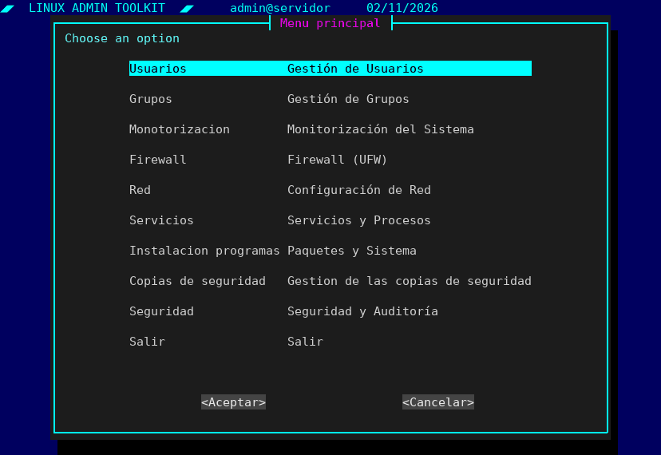
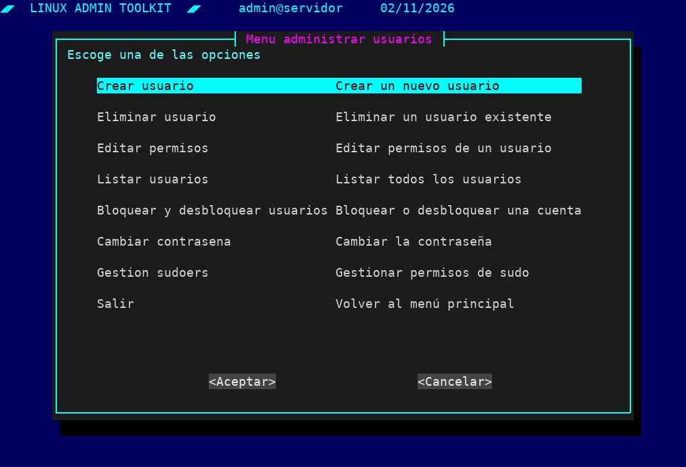
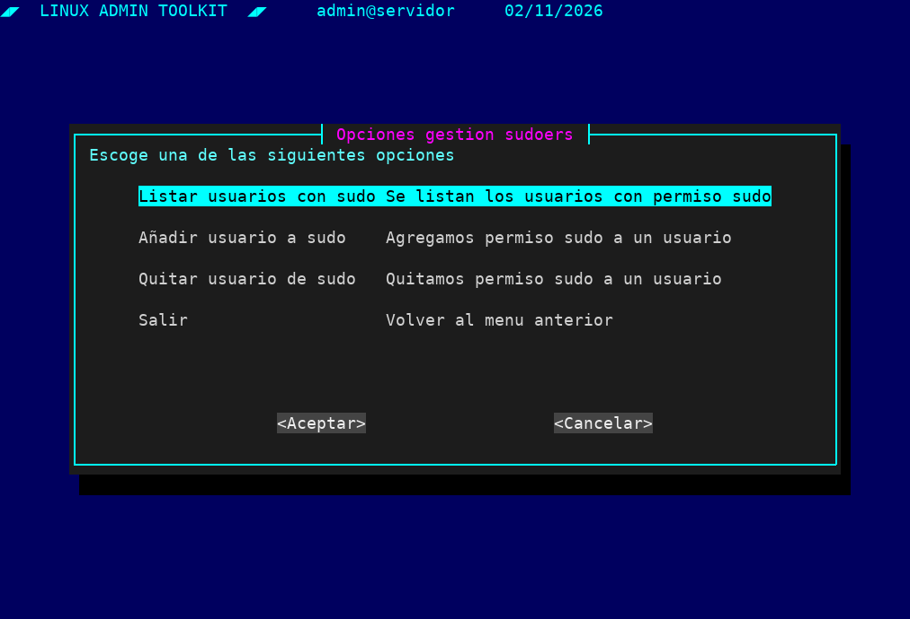
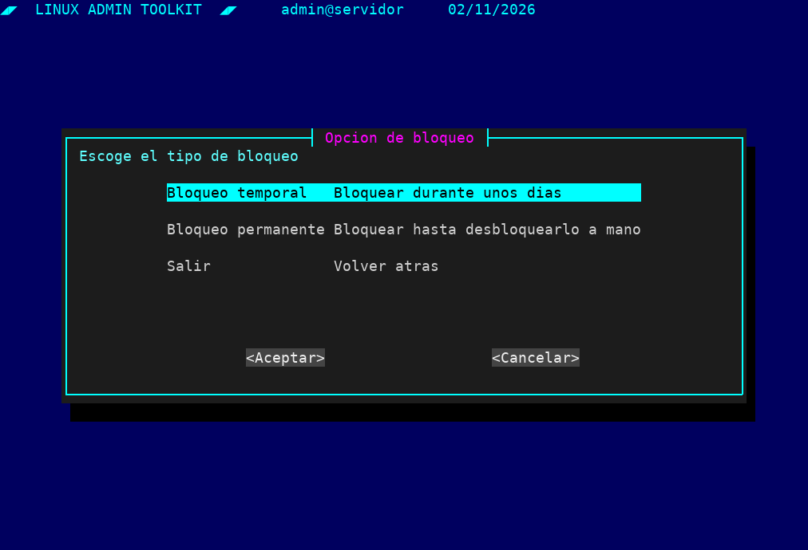

<h1 align="center">linux-admin-toolkit</h1>

<p align="center">
  <b>Manage a Linux server from menus in your terminal.</b><br>
  Users, passwords, account locks and sudo permissions, without having to remember every command.
</p>

<p align="center">
  <b>English</b> · <a href="README.es.md">Español</a>
</p>

<p align="center">
  <a href="https://github.com/RobertMartiB/linux-admin-toolkit/actions/workflows/shellcheck.yml"></a>
  
  
  
  
</p>

<p align="center">
  
</p>

> The interface is currently in Spanish. An English translation of the menus is on the roadmap.

---

## Contents

- [Quick start](#quick-start)
- [What it does](#what-it-does)
- [A tour of the menus](#a-tour-of-the-menus)
- [How temporary locks work](#how-temporary-locks-work)
- [Roadmap](#roadmap)
- [Contributing](#contributing)
- [Author](#author)

## Quick start

```bash
sudo apt install whiptail
curl -fsSLO https://raw.githubusercontent.com/RobertMartiB/linux-admin-toolkit/main/GestorSistema.sh && chmod +x GestorSistema.sh && ./GestorSistema.sh
```

Or clone the repository:

```bash
git clone https://github.com/RobertMartiB/linux-admin-toolkit.git
cd linux-admin-toolkit
./GestorSistema.sh
```

Requires Linux with **systemd** (built for Debian and Ubuntu), plus `bash`, `whiptail` and `sudo`. Actions that change the system run through `sudo`, so you need an administrator account.

## What it does

| Area | What you can do |
|---|---|
| **Users** | Create, delete, list and change passwords, with checks to prevent mistakes. |
| **Locks** | Lock and unlock accounts, permanently or **for X days**. |
| **Sudo** | See who has sudo, grant it, revoke it, or create a user that already has it. |
| **Interface** | whiptail menus with a custom colour theme. |

**User management**

- **Create users** with a home directory and Bash shell, checking the name is free and the password has at least 8 characters.
- **Delete users** along with their home directory, after confirmation. `root` can't be deleted.
- **List users**: real (UID ≥ 1000), system (UID < 1000) or all.
- **Change passwords**: checks the user exists and asks for the new password twice, hidden.
- **Lock and unlock accounts**, permanently or **temporarily for X days**.
  - Locking disables the password and expires the account, so SSH key logins are blocked too.
  - You can't lock `root` or the administrator running the tool.

**`sudoers` management**

- **See which users have sudo** (members of the `sudo` group).
- **Grant sudo** to an existing user, or **create a new user** with sudo straight away.
- **Revoke sudo**, after confirmation.
  - You can't revoke sudo from `root` or from the administrator running the tool, so you never lock yourself out.

**Interface**

- whiptail menus with a custom 256-colour theme, and a fallback theme for 8-colour terminals.
- If launched with `sh` (dash), it re-runs itself with `bash` automatically.

## A tour of the menus

<p align="center">
  
</p>

<table>
  <tr>
    <td width="50%"></td>
    <td width="50%"></td>
  </tr>
  <tr>
    <td align="center"><b>Sudoers</b><br>Grant, revoke and list sudo permissions.</td>
    <td align="center"><b>Account locks</b><br>Temporary for a few days, or permanent.</td>
  </tr>
</table>

## How temporary locks work

Instead of leaving a `cron` job or a `sleep` running, the tool schedules a **systemd timer** that undoes the change by itself:

```bash
# Lock now…
sudo usermod -L -e 1 "$Usuario"

# …and schedule the unlock after X days
sudo systemd-run --unit="estado-usuario-$Usuario" \
    --on-active="${Dias}d" --timer-property=AccuracySec=1min \
    /usr/sbin/usermod -U -e "" "$Usuario"
```

Each user has a single `estado-usuario-<user>` unit. If you change your mind, the tool cancels the pending timer before applying the new state.

## Roadmap

- [ ] Edit user permissions
- [ ] Group management
- [ ] System monitoring
- [ ] Firewall (UFW)
- [ ] Network configuration
- [ ] Services and processes
- [ ] Packages and updates
- [ ] Backups
- [ ] Security and auditing
- [ ] English translation of the menus

## Contributing

Ideas, bug reports and pull requests are welcome. Issues labelled [`good first issue`](https://github.com/RobertMartiB/linux-admin-toolkit/labels/good%20first%20issue) are a good place to start.

## Author

**Robert Martí**, systems technician (CFGS ASIX) and Computer Engineering student at the UOC.

[LinkedIn](https://www.linkedin.com/in/robert-marti-badia-119710235/) · [Portfolio](https://robertmartib.github.io/portfolio-robert/)

## License

[MIT](LICENSE)
