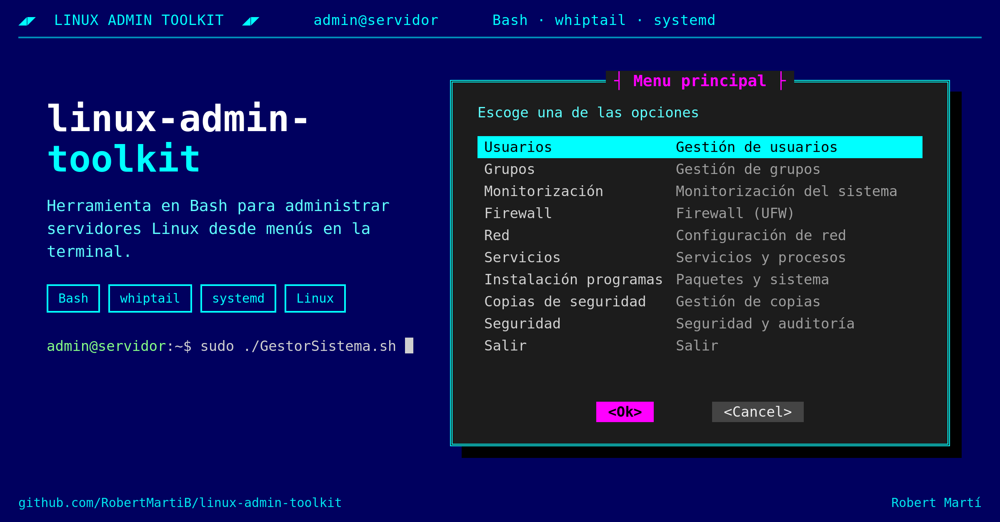

# linux-admin-toolkit




Herramienta en **Bash** para administrar servidores Linux desde **menús en la terminal** (whiptail), sin tener que recordar cada comando.

*Modular Linux sysadmin toolkit with a TUI: users, groups, firewall, network, monitoring and more.*

## Qué hace ahora

**Gestión de usuarios**

- **Crear usuarios** con carpeta personal y shell Bash, comprobando que el nombre no exista y que la contraseña tenga al menos 8 caracteres.
- **Eliminar usuarios** junto con su carpeta personal, con confirmación previa. No deja borrar `root`.
- **Listar usuarios**: reales (UID ≥ 1000), de sistema (UID < 1000) o todos.
- **Cambiar contraseñas** de cualquier usuario: comprueba que el usuario exista y pide la nueva contraseña dos veces, sin mostrarla, para evitar errores al escribirla.
- **Bloquear y desbloquear cuentas**, de forma permanente o **temporal durante X días**.
  - El bloqueo desactiva la contraseña y caduca la cuenta, así que tampoco se puede entrar por SSH con clave.
  - No permite bloquear a `root` ni al administrador que está usando la herramienta.

**Gestión de `sudoers`**

- **Ver qué usuarios tienen sudo** (miembros del grupo `sudo`).
- **Dar permisos de sudo** a un usuario que ya existe, o **crear un usuario nuevo** directamente con sudo.
- **Quitar permisos de sudo**, con confirmación previa.
  - No deja quitar sudo a `root` ni al administrador que está usando la herramienta, para no quedarse sin acceso.

**Interfaz**

- Menús con whiptail y tema propio de 256 colores, con un tema alternativo para terminales de 8 colores.
- Si se lanza con `sh` (dash), se vuelve a ejecutar con `bash` automáticamente.

## Cómo funciona el bloqueo temporal

En lugar de dejar un `cron` o un `sleep` en marcha, la herramienta programa un **temporizador de systemd** que deshace el cambio solo:

```bash
# Bloquear ahora…
sudo usermod -L -e 1 "$Usuario"

# …y programar el desbloqueo pasados X días
sudo systemd-run --unit="estado-usuario-$Usuario" \
    --on-active="${Dias}d" --timer-property=AccuracySec=1min \
    /usr/sbin/usermod -U -e "" "$Usuario"
```

Cada usuario tiene una sola unidad `estado-usuario-<usuario>`. Si se cambia de idea, la herramienta cancela el temporizador pendiente antes de aplicar el nuevo estado.

## En desarrollo

- [ ] Editar permisos de usuarios
- [ ] Gestión de grupos
- [ ] Monitorización del sistema
- [ ] Firewall (UFW)
- [ ] Configuración de red
- [ ] Servicios y procesos
- [ ] Paquetes y actualizaciones
- [ ] Copias de seguridad
- [ ] Seguridad y auditoría

## Requisitos

- Linux con **systemd**, pensado para Debian y Ubuntu.
- `bash`, `whiptail` y `sudo`.

```bash
sudo apt install whiptail
```

## Uso

```bash
git clone https://github.com/RobertMartiB/linux-admin-toolkit.git
cd linux-admin-toolkit
chmod +x GestorSistema.sh
./GestorSistema.sh
```

Las acciones que modifican el sistema usan `sudo`, así que hace falta un usuario con permisos de administrador.

## Autor

**Robert Martí**, técnico de sistemas (CFGS ASIX) y estudiante de Ingeniería Informática en la UOC.

[LinkedIn](https://www.linkedin.com/in/robert-marti-badia-119710235/) · [Portfolio](https://robertmartib.github.io/portfolio-robert/)

## Licencia

[MIT](LICENSE)
